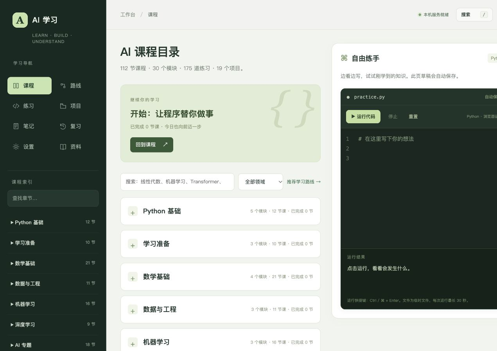
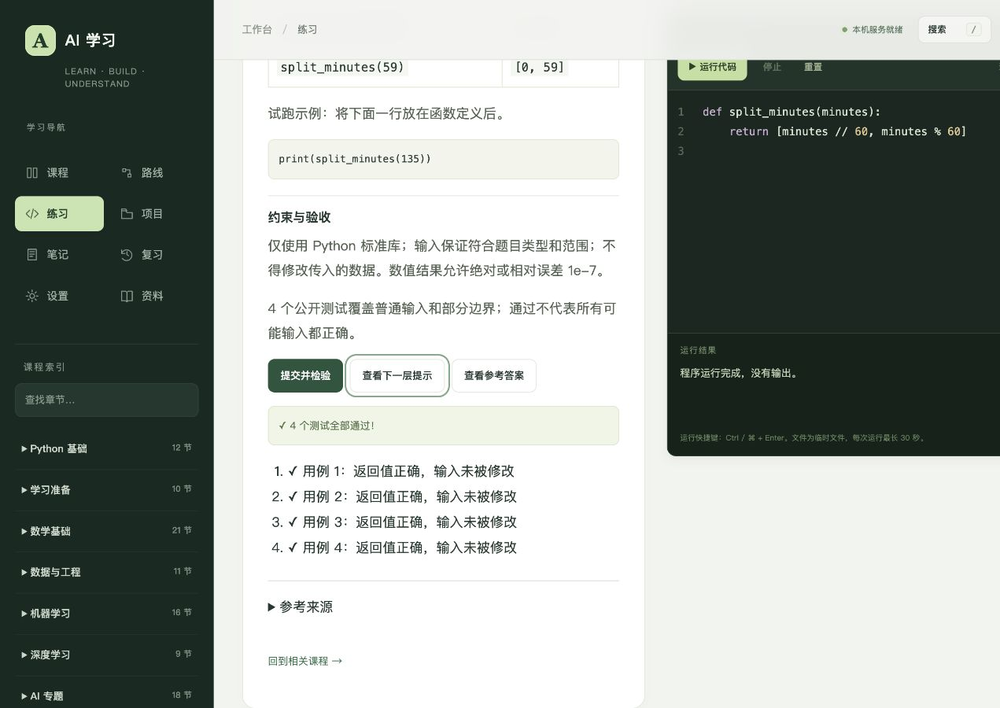

# AI 学习网站 · 课程作业

一个面向个人学习者的中文 Python 与 AI 学习网站，将课程讲解、代码实验、练习、项目和学习记录放在同一个页面中。

## 如何查看

安装 Python 3 后，在项目文件夹启动：

```sh
python3 server.py
```

Windows 可运行 `py -3 server.py`，或使用 `python server.py`。浏览器打开 http://127.0.0.1:5278/ 。保持运行命令的窗口打开；按 Ctrl+C 停止。

Mac 也可双击“打开AI学习.command”，Windows 可双击“打开AI学习.cmd”。双击入口在后台启动；命令行启动适合老师直接检查。使用者无需安装 Node.js 或前端依赖。

> GitHub 仓库页面展示源码，不等于网站已托管。127.0.0.1 是当前电脑的地址，需要先运行本项目。

## 功能

- 112节图文课程、30个模块，覆盖Python、数学基础、机器学习与AI应用。
- 浏览器内编写并真实执行Python；支持停止和30秒超时。
- 175道练习、19个项目，包含分级提示、参考答案、测试反馈。
- 课程笔记、代码草稿、学习进度、收藏、深浅主题和数据备份。
- 新增60道函数练习与12个项目，共242个公开行为用例；其余配套题按指定示例输出校验。

## 提交材料

- [项目介绍](docs/01-项目介绍.md)
- [启动与使用说明](docs/02-使用说明.md)
- [测试报告](docs/03-测试报告.md)
- [演示脚本](docs/04-演示脚本.md)
- [AI辅助与参考来源](docs/05-AI辅助与参考来源.md)
- `docs/screenshots/`：实际页面截图。
- [查看演示视频（2分10秒，无旁白）](docs/demo.mp4)。完整压缩包随作业文件交付。

## 技术与目录

HTML、CSS、JavaScript构建前端；Pyodide/WebAssembly在Web Worker中运行Python；Python标准库提供仅限本机访问的静态服务；localStorage保存个人数据。

```text
dist/           网页、教学内容、图解和浏览器Python运行环境
curriculum/     内容生成脚本与检查脚本
server.py       本机启动服务
docs/           作业说明与截图
```

浏览器Python运行环境随源码附带，无需在页面加载时从外网下载。其第三方许可见 `dist/python/LICENSE`。完整框架训练、GPU和AI聊天服务未接入；五个框架示例仅供本地下载学习。个人记录不自动跨设备同步。详见说明文档。

## 检查

开发时安装 Node.js 和 Python 3 后执行：

```sh
node curriculum/check-pages.mjs
node curriculum/check-beginner.mjs
node curriculum/check-practice.mjs
```

课程及界面由作者在AI辅助下设计、生成、修改并验证。请按课程规定披露AI使用情况，提交者需能解释主要设计与实现。

## 页面预览




